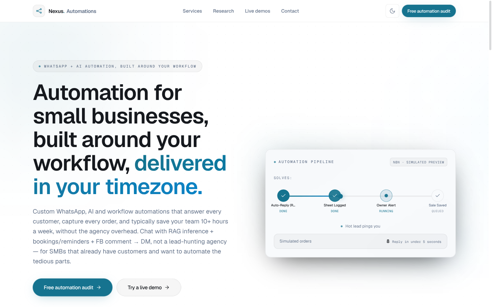
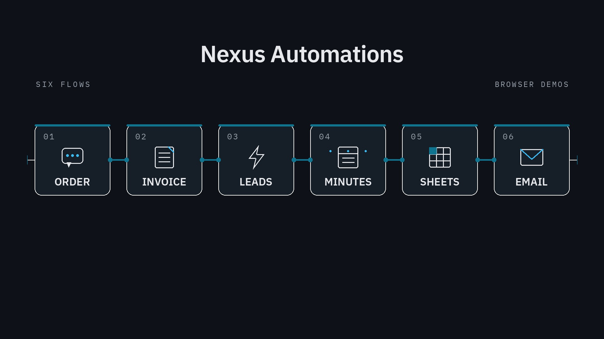
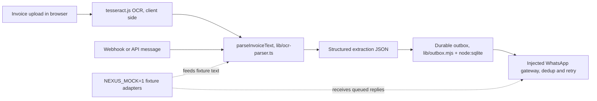

# Nexus Automations

**A working showcase of custom workflow automation, built for small business owners who want to see the flow before they book a call.**

[](https://github.com/ibraramin/Nexus-Automations/actions/workflows/ci.yml)
[](LICENSE)
[](https://nodejs.org/)
[](https://github.com/ibraramin/Nexus-Automations/releases)



[](docs/assets/brag.mp4)

https://github.com/user-attachments/assets/82ab9469-00a3-479a-b46c-ca9b7b8db9e8


Nexus Automations is the public front end for WhatsApp, web, email and phone workflow automation. Every flow you can click through in the browser is paired with a tested core: an invoice OCR parser and a durable reply outbox that run offline with no provider credentials.

## What you can explore

- **OCR invoice processing.** Upload an invoice in the browser and tesseract.js reads it, then a pure parser (`lib/ocr-parser.ts`) extracts vendor, invoice number, date, VAT, totals and line items. The same parser is checked against three committed fixtures with golden outputs and per-field confidence floors.
- **WhatsApp order bot.** A browser walkthrough takes a customer from product and size selection through bKash payment confirmation to Pathao courier dispatch. Behind the chat, replies move through a SQLite outbox with deduplication and bounded retries.
- **n8n workflows.** Six ready-to-import workflow JSON files ship as static downloads, covering the order bot, invoice reader, lead response, meeting minutes, spreadsheet cleanup and email triage.
- **Browser demos.** Six interactive demos run entirely client side, with no account, token or backend required. Run `npm run dev`, then open `http://localhost:3000/demos/`:
  - `whatsapp-order-bot`
  - `ai-invoice-reader`
  - `lightning-lead-response`
  - `meeting-minutes-bot`
  - `spreadsheet-rescue`
  - `email-triage`

Demo URLs use the production domain configured in `app/layout.tsx`. Download the workflow JSON directly from the repository: [WhatsApp Order Bot](public/downloads/whatsapp-order-bot.json) · [Invoice Reader](public/downloads/ai-invoice-reader.json) · [Lead Response](public/downloads/lightning-lead-response.json) · [Meeting Minutes](public/downloads/meeting-minutes-bot.json) · [Spreadsheet Rescue](public/downloads/spreadsheet-rescue.json) · [Email Triage](public/downloads/email-triage.json)


The offline demo prints five numbered steps: mock guard, fixture seeding through the fake OCR adapter, negative fixture flagging, deduplication and outbox, then a flush with one injected transient gateway failure. It ends with `PASS` and exits non-zero on any failed assertion.

## Quickstart

Everything below runs offline. The unit tests need no provider token, no external HTTP request and no n8n execution. The browser tests serve the static export over loopback.

```bash
npm ci                       # install exactly from package-lock.json
npm test                     # 19 tests: 7 OCR + 12 outbox
npm run build                # static export into out/
NEXUS_MOCK=1 npm run demo    # both flows end to end, offline
npx playwright test          # 2 chromium e2e tests against out/ (build first)
npx tsc --noEmit             # typecheck
npx eslint .                 # lint
```

Local development and deployment:

```bash
npm run dev      # http://localhost:3000
npm run deploy   # npm run build then wrangler deploy, static assets from out/
```

Node 26 or newer is required. CI pins Node 26, matching the local verification runtime 26.11.1, because that gives `node --test` native TypeScript type stripping and stable `node:sqlite`. The unit suites use Node's built-in test runner and assertions. Playwright is pinned at 1.63.0 as a dev-only dependency and is used only for the browser checks.

## Architecture



In the shipped site the OCR text comes from tesseract.js in the browser. In tests and in the demo the same parser consumes checked-in text fixtures through an in-memory adapter. Replies are queued in a real SQLite outbox and delivered to an injected gateway, with no provider token and no HTTP request.

## Results at a glance

| Area | Verified result |
| --- | --- |
| Tests | **19/19 pass**: 7 golden OCR + 12 outbox tests via `node --test` |
| Browser tests | **2/2 Playwright chromium tests** pass against the static export served over loopback |
| Build | **15/15 static pages** written into `out/` |
| Demo | Ends with **PASS** and **3 replies sent** |
| Fixtures | 3: Acme and TechParts positive invoices, plus `incomplete-invoice.txt` |
| Confidence floors | vendor 92 · invoice # 88 · date 90 · total 85 · VAT 82 · lines 80 |
| Outbox | `maxAttempts` 3 · dedup via `seen_messages` primary key · stale-sending lease reclaim · injected gateway |
| Stack | Next.js 16.3.0 · React 19 · TypeScript strict |
| Runtime | Node >= 26, verified on 26.11.1 |
| Dependencies | One pinned dev-only test dependency, `@playwright/test` 1.63.0; no runtime test dependency added |
| License | MIT |

## Configuration

The only environment variable read by the current code is `NEXUS_MOCK`, used by the offline demo. The command above sets it. No values are committed, and `.env.example` is the only tracked env file. Provider credential names (`WHATSAPP_ACCESS_TOKEN`, `WHATSAPP_PHONE_NUMBER_ID`, `WEBHOOK_VERIFY_TOKEN`, `OPENAI_API_KEY`) are documented for deployment setups; the static build does not read them.

## Scope and boundaries

- The site is a static export. It has no server runtime and no API routes.
- The browser demos are scripted walkthroughs over sample data. They do not call OpenAI, WhatsApp, bKash or Pathao. The contact form posts to Web3Forms with a mailto fallback.
- The n8n JSON files under `public/downloads/` and `blueprints/` are downloadable workflow definitions, not code executed by this repository.
- Confidence numbers are fixed heuristic values used as a regression signal, not calibrated probabilities.
- Outbox delivery is at least once. A gateway that sends then throws can deliver twice, so a hosted integration would use provider idempotency keys.
- OCR upload runs in the browser. The Node tests use checked-in text fixtures and never start an OCR engine.
- Browser tests cover the static export over loopback. Outbox counters are in-process values from the injected gateway, not a hosted collector.

## Repository layout

```
app/                       # Home, services, demos, contact, privacy, research
components/demos/          # WhatsAppOrderBot, InvoiceReader and other demos
lib/demos.ts               # Demo registry
lib/ocr-parser.ts          # Pure invoice extraction, tested
lib/outbox.mjs             # SQLite dedup and outbox, tested
tests/                     # node:test suites, fixtures and goldens
playwright.config.ts       # chromium e2e config, serves out/ over loopback
e2e/                       # Playwright static-site e2e specs
scripts/demo.mjs           # NEXUS_MOCK=1 end-to-end demo
public/downloads/          # Downloadable n8n workflow JSON
blueprints/                # Service spec sheets and example workflows
docs/plans, docs/specs     # Repository and feature documentation
```

## Deployment

`next.config.ts` sets `output: "export"`. `next build` writes plain HTML, CSS and JavaScript into `out/`, and `wrangler.jsonc` serves that directory as Cloudflare Workers assets with a 404 fallback. There is no Node server, so `npm run start` is not a deployment path. Preview the build with any static file server, for example `npx serve out`.

Run locally with `npm run dev`; no hosted deployment is published in this repository.

## Documentation

- [Architecture](docs/ARCHITECTURE.md): static export, OCR and outbox flows, state model, file map.
- [Usage](docs/USAGE.md): local commands, fixtures, parser and outbox cookbook, offline demo.
- [Deployment](docs/DEPLOYMENT.md): static build, Cloudflare Workers assets, preview, Node and CI parity.
- [Contributing](CONTRIBUTING.md): branch workflow, definition-of-done commands, CI checks and rules.

## Links

- Source: [github.com/ibraramin/Nexus-Automations](https://github.com/ibraramin/Nexus-Automations)
- Releases: [v0.2.0](https://github.com/ibraramin/Nexus-Automations/releases)
- Talk to us: [WhatsApp](https://wa.me/8801333095960) or [email](mailto:ibrarshafin2002@gmail.com)

## License

MIT. See [LICENSE](LICENSE). Copyright (c) 2026 Ibrar Amin.
