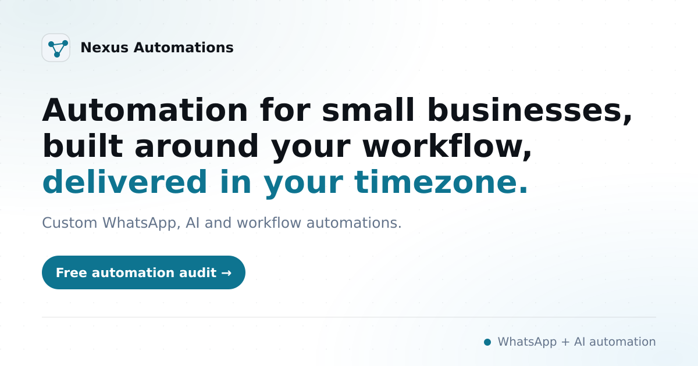
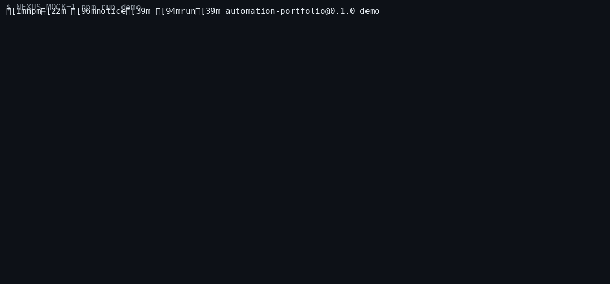
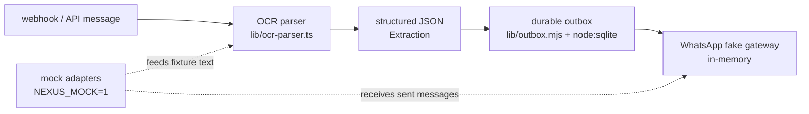

# Nexus Automations — verifiable showcase site

**Custom n8n + AI automation for WhatsApp, web, email and phone — with the core logic backed by offline, repeatable tests and a two-minute demo.**

[](https://github.com/ibraramin/automation-portfolio/actions/workflows/ci.yml)
[](LICENSE)
[](https://nodejs.org/)
[](https://github.com/ibraramin/automation-portfolio/releases)



Client-facing showcase for **Nexus Automations**: custom n8n + AI automation across
WhatsApp, web, email and phone. This repository is the interactive front end. The
point of the verifiability pass is that the interesting logic is no longer only
behind a browser click: the invoice parser and the webhook/outbox have real,
offline, repeatable tests, plus a one-command demo that exercises both flows.

> Prior pivot context: the unified `00-omni-chat-core` build and specs 01–10 are
> tracked in `docs/specs/Omni-Unified-Spec.md`, `docs/plans/Omni-Unified.md` and
> `blueprints/README.md`. This README describes this repo as it exists today.



`NEXUS_MOCK=1 npm run demo` prints five numbered steps: mock guard, fixture
seeding through the fake OCR adapter, negative-fixture flagging, dedup +
outbox, and a flush with one injected transient gateway failure. It ends with
`PASS` and a non-zero exit on any failed assertion.

## Verify in 2 minutes

Everything below runs offline, with no provider token, no HTTP request and no
n8n execution.

```bash
npm ci                       # install exactly from package-lock.json
npm test                     # node --test: golden OCR tests + outbox tests
npm run build                # Next.js static export into out/
NEXUS_MOCK=1 npm run demo    # both flows end to end, offline
npx tsc --noEmit             # typecheck
npx eslint .                 # lint
```

Local development and deployment:

```bash
npm run dev      # http://localhost:3000
npm run deploy   # npm run build && wrangler deploy (static assets from out/)
```

`npm test` uses Node's built-in runner (`node --test`) and built-in assertions
and `node:sqlite`; no test runner or extra dependency was added. CI pins
**Node 26**, matching the runtime used to verify this repo, because that gives
native TypeScript type stripping in `node --test` and stable `node:sqlite`.
`package.json` therefore declares `engines.node >= 26` (earlier Node versions
cannot run these tests). Local verification ran on Node 26.11.1.

## Architecture



In the shipped website the OCR text comes from tesseract.js in the browser. In
tests and in the demo the *same* parser consumes checked-in text fixtures
through an in-memory fake OCR adapter. Replies are queued in a real SQLite
outbox and delivered to an injected fake WhatsApp gateway — no provider token,
no HTTP request, no n8n execution.

## Features

The verifiable core, file by file:

- `lib/ocr-parser.ts` — pure `parseInvoiceText(text): Extraction`, extracted
  from `components/demos/InvoiceReader.tsx` (the component now imports it).
- `tests/fixtures/*.txt` — **3 fixtures**: 2 positive invoices (Acme,
  TechParts) and 1 negative invoice (`incomplete-invoice.txt`, missing date).
- `tests/fixtures/*.expected.json` — checked-in golden outputs, deep-equality
  compared for every fixture.
- `tests/ocr.test.mjs` — golden tests, measured per-field confidence floors
  (vendor 92, invoice # 88, date 90, total 85, VAT 82, lines 80) and an
  explicit "negative fixture is flagged" assertion.
- `lib/outbox.mjs` + `tests/outbox.test.mjs` — SQLite dedup/outbox with an
  injected gateway: duplicate ids ignored, replies queued, bounded retries,
  permanent failures marked `failed`, and a file-backed restart test.
- `scripts/demo.mjs` — the offline end-to-end walkthrough described above.

## Results at a glance

| Area | Verified result |
| --- | --- |
| Tests | **16/16 pass** — golden OCR tests + outbox tests |
| Build | **15/15 static pages generated** into `out/` |
| Demo | Ends with **PASS**; **3 replies sent** |
| Fixtures | 3: Acme, TechParts (positive) and `incomplete-invoice.txt` (negative) |
| Confidence floors | vendor 92 · invoice # 88 · date 90 · total 85 · VAT 82 · lines 80 (lines 0 when absent) |
| Outbox | `maxAttempts` 3 · dedup via `seen_messages` primary key · stale-sending lease reclaim · injected fake gateway |
| Stack | Next.js 16.3.0 · React 19 · TypeScript strict |
| Runtime | Node >= 26 (native TS stripping + `node:sqlite`); verified on Node 26.11.1 |
| Dependencies | Zero new external dependencies |
| License | MIT |

## Environment variables

Names only — no values are committed, and `.env.example` is the only tracked
env file (`.env*` is otherwise ignored).

| Name | Needed locally? | Purpose |
| --- | --- | --- |
| `NEXUS_MOCK` | Only for `npm run demo` | Switches to in-memory OCR/gateway adapters; the command above sets it. |
| `WHATSAPP_ACCESS_TOKEN` | No | Reserved name for a future integration; unused here. |
| `WHATSAPP_PHONE_NUMBER_ID` | No | Reserved name; unused here. |
| `WEBHOOK_VERIFY_TOKEN` | No | Reserved name; unused here. |
| `OPENAI_API_KEY` | No | Reserved name; unused here. |

## Structure

```
app/                       # Home, services, demos, contact, privacy
components/demos/          # WhatsAppOrderBot, InvoiceReader, and other demos
lib/demos.ts               # Demo registry
lib/ocr-parser.ts          # Pure invoice extraction (tested)
lib/outbox.mjs             # SQLite dedup + outbox (tested)
tests/                     # node:test suites + fixtures/goldens
scripts/demo.mjs           # NEXUS_MOCK=1 end-to-end demo
public/downloads/          # n8n workflow JSON lead magnets (static data)
blueprints/                # Service spec sheets / example workflow JSON
docs/plans, docs/specs     # Repo and feature specs
```

## Deploy

The site is a fully static export (`output: "export"` in `next.config.ts`).
`next build` writes plain HTML/CSS/JS into `out/`, and `wrangler.jsonc` serves
that directory as Cloudflare Workers assets. There is no Node server, so
`npm run start` is not usable with this export; preview with any static file
server (for example `npx serve out`).

## Limitations (honest)

- **Static export only.** No `app/api` routes and no server runtime can be
  added without changing the deployment model.
- **No real API calls.** The contact form posts to Web3Forms with a mailto
  fallback; the demos do not call OpenAI, WhatsApp, bKash or Pathao. The n8n
  JSON under `public/downloads/` and `blueprints/` is static downloadable
  data, not code executed by this repo.
- **WhatsApp bot is a simulation.** `components/demos/WhatsAppOrderBot.tsx`
  is a client-side state machine with `setTimeout` and fake bKash/Pathao
  steps. The demo's gateway is an in-memory array, not a WhatsApp client.
- **Confidence numbers are heuristic constants**, not calibrated model
  probabilities: all fields report fixed scores, and `lines` drops to 0 when
  no line items were found. They are useful as a regression signal, not as a
  measure of extraction correctness.
- **At-least-once delivery.** The outbox retries after gateway errors; a
  gateway that sends and then throws could be delivered twice. A production
  integration would need provider idempotency keys.
- **OCR upload is browser-only.** tesseract.js is lazy-loaded client side;
  the Node tests never invoke an OCR engine.

## Documentation

- [Architecture](docs/ARCHITECTURE.md) — static export, OCR and outbox flows, state model, file map.
- [Usage](docs/USAGE.md) — local commands, fixtures, parser and outbox cookbook, offline demo.
- [Deployment](docs/DEPLOYMENT.md) — static build, Cloudflare Workers assets, preview, Node/CI parity.
- [Contributing](CONTRIBUTING.md) — branch workflow, DoD commands, CI checks and rules.

## License

MIT — see [LICENSE](LICENSE). Copyright (c) 2026 Ibrar Amin.
