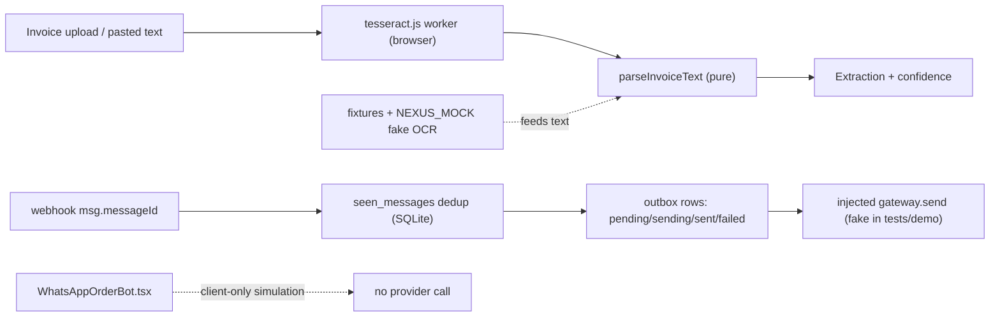

# Architecture

This document describes the repository as it exists on this branch. Every claim
is grounded in the files listed in the [file map](#file-by-file-map). No HTTP
endpoints or provider calls are described unless the code actually contains them.

## Deployment shape: a static export

`next.config.ts` sets `output: "export"`. `next build` therefore emits plain
HTML/CSS/JS into `out/` rather than running a server. `wrangler.jsonc` points
`assets.directory` at `./out` with `not_found_handling: "404-page"`, so the
published artifact is a set of static files served as Cloudflare Workers assets.
There are no `app/api` route handlers and no server runtime in this repo.

`tsconfig.json` uses strict mode, `allowJs`, `noEmit`, bundler module resolution
and the `@/*` path alias to the repo root. The JavaScript modules
(`lib/outbox.mjs`, the test files and the demo script) are deliberately plain
`.mjs`: the installed `@types/node` is v20 and does not type `node:sqlite`, while
the Node 26 runtime provides that module natively.

## The two flows

The README draws one visual flow (webhook/API message -> OCR parser ->
Extraction -> durable outbox -> WhatsApp fake gateway). In the shipped site the
two halves are separate: the browser demo runs OCR on uploaded or pasted text,
and the webhook/outbox code is a library exercised by the offline tests and
demo. There is no HTTP webhook endpoint in this repository.

### OCR flow (browser -> parser -> Extraction)

`components/demos/InvoiceReader.tsx` is a client component:

1. The user picks a checked-in sample (`SAMPLES`, with `source: "sample"`),
   uploads an image, or pastes text after OCR fails.
2. On upload the component dynamically imports `createWorker` from
   `tesseract.js`, creates an `"eng"` worker, calls `worker.recognize(file)`,
   reads `data.text`, trims it, terminates the worker and requires at least 20
   characters. Under 20 characters (or any thrown error) it sets `ocrStatus` to
   `failed`, shows the paste fallback and clears the extraction.
3. Otherwise it calls `parseInvoiceText(text)` and renders the result. Pasted
   text goes through the same call; the sample buttons use prebuilt `Extraction`
   objects instead.

`lib/ocr-parser.ts` exports the pure, dependency-free function
`parseInvoiceText(text: string): Extraction`. It does no network, filesystem or
DOM access and is deterministic for a given input string. Its `Extraction` shape
is `source`, `vendor`, `invoiceNumber`, `date`, `totalEur`, `vatEur`, `vatRate`,
`lines`, `confidence`, `validated` and `missing`. It extracts:

- `vendor`: a name ending in a known company suffix (`GmbH`, `Ltd`, `B.V.`,
  `S.A.`, `UG`, `AG`, `PLC`, `Corp`, `Co.`), else the first short alphabetic
  line, else `"Unknown vendor"`.
- `invoiceNumber`: an `invoice no/number/#` pattern or an `INV`/`2026`-style id,
  else `"Unknown"`.
- `date`: `dd.mm.yyyy`/`dd/mm/yyyy` or `yyyy-mm-dd`, else `"Unknown"`.
- `totalEur`: `total`, `amount due`, `grand total`, `summe` or `gesamt` followed
  by a number; `vatEur`: `vat`, `mws(t)`, `tax` or `ust`. The internal
  `parseMoney` helper handles European comma/dot separators.
- `vatRate`: an explicit `N%` rate, otherwise derived as
  `round(vatEur / (totalEur - vatEur) * 100)`, otherwise 0.
- `lines`: up to 8 lines that start with a digit and end in a number or `€`,
  with the description capped at 60 characters, leading digits used as `qty`,
  unit `"pcs"` and the trailing number as `amount`. Zero-amount lines are
  dropped.
- `missing[]`: `vendor`, `invoiceNumber`, `date` and `totalEur` when absent or
  unknown. `validated = missing.length === 0`.
- `confidence`: fixed constants — vendor 92, invoiceNumber 88, date 90,
  totalEur 85, vatEur 82, and lines 80 when line items exist, 0 otherwise.
- `source`: always `"ocr"` for parser output, including pasted text.

The component shows those confidence numbers as progress bars, lists the line
items, and offers a "Log to ledger" action that appends the extraction to
in-memory state with a `loggedAt` date. That ledger is UI-only; the explanatory
text under it describes a possible n8n/Google Sheets write, but no such write
happens in this repo.

### WhatsApp flow (webhook -> dedup -> outbox -> gateway)

`components/demos/WhatsAppOrderBot.tsx` is a separate client-only state machine.
Its `Stage` values are `idle`, `size`, `address`, `payment`, `verifying`,
`confirmed`, `shipped` and `outfordelivery`; it uses `setTimeout`-based delays
through its `delay` helper, quick-reply chips and a random `SN-####` order
number. bKash payment and Pathao tracking are simulated strings — no WhatsApp,
bKash or Pathao API is called.

The durable webhook path is `lib/outbox.mjs` and does not live in that component.
A caller supplies a message with a `messageId`; `handleWebhook(msg)`:

1. Throws `TypeError` if `messageId` is not a non-empty string.
2. Opens `BEGIN IMMEDIATE` and inserts the id into `seen_messages` with
   `ON CONFLICT(message_id) DO NOTHING`. Zero changes means a duplicate: it
   rolls back and returns `{ status: "duplicate", messageId: msg.messageId,
   enqueued: false }`.
3. Otherwise it builds a reply with `buildReply(msg)` (default
   `{ to: msg.from ?? "unknown", text: "Ack: " + (msg.text ?? "") }`), inserts
   one `outbox` row with `status: "pending"` and `attempts: 0`, commits, and
   returns `{ status: "accepted", messageId: msg.messageId, enqueued: true }`.
   Any thrown error rolls the
   transaction back and is rethrown.

`flush()` drains the queue through an injected gateway whose `send(msg)`
function is the only delivery mechanism. There is no built-in provider client
and no network call in the module.

### Outbox state model

Tables created by `createOutbox`:

- `seen_messages(message_id TEXT PRIMARY KEY, received_at TEXT NOT NULL)`.
- `outbox(id INTEGER PRIMARY KEY AUTOINCREMENT, message_id TEXT NOT NULL,
  payload TEXT NOT NULL, attempts INTEGER NOT NULL DEFAULT 0, status TEXT NOT
  NULL DEFAULT 'pending', created_at TEXT NOT NULL, sending_at TEXT, sent_at
  TEXT, last_error TEXT)`. A small migration adds `sending_at` when opening a
  database created by an earlier version.

Statuses are `pending`, `sending`, `sent` and `failed`. `maxAttempts` defaults to
3 and `leaseMs` to 30000; both must be positive integers. `now` is an injected
clock defaulting to `() => new Date().toISOString()`.

On each `flush()`:

1. Stale `sending` rows (no `sending_at`, or older than `now - leaseMs`) are
   reclaimed: `attempts >= maxAttempts` becomes `failed`, otherwise `pending`,
   with `last_error = "reclaimed after lease"`. A non-parseable clock falls back
   to `Date.now()` for the cutoff.
2. Rows in `pending`/`failed` with `attempts < maxAttempts` are selected in id
   order. Each is atomically claimed with `UPDATE ... SET status = 'sending',
   attempts = attempts + 1, sending_at = now ... RETURNING attempts`, so two
   workers sharing a file-backed database cannot both send the same row.
3. `gateway.send(JSON.parse(payload))` runs. Success sets `sent` and `sent_at`;
   an error sets `failed` when the attempt limit is reached, otherwise
   `pending`, and stores the error message in `last_error`. `flush()` returns a
   result array of `{ id, status, attempts }` plus `error` on failure.

`stats()` returns `{ seen, outbox: { <status>: count } }`; `close()` closes the
database, and the returned object also exposes `db`. A `:memory:` database keeps
everything in-process (tests and demo); a file-backed `DatabaseSync` keeps dedup
and queued rows across restarts (covered by a test). Delivery is at-least-once: a
gateway that sends and then throws can be retried and delivered twice, so a
production integration would need provider idempotency keys.

### Mock adapters and NEXUS_MOCK

`scripts/demo.mjs` asserts `process.env.NEXUS_MOCK === "1"` as its first step.
With that flag the fake OCR adapter is `{ recognize: async (text) =>
parseInvoiceText(text) }` over checked-in `.txt` fixtures, and the fake WhatsApp
gateway is an in-memory array whose `send` throws once to simulate a transient
outage. The outbox itself is real `node:sqlite` code running on an in-memory
database. No credentials, network requests or tesseract worker are involved.

`.env.example` lists names only: `NEXUS_MOCK` plus reserved, currently unused
`WHATSAPP_ACCESS_TOKEN`, `WHATSAPP_PHONE_NUMBER_ID`, `WEBHOOK_VERIFY_TOKEN` and
`OPENAI_API_KEY`. No tracked env file holds values and no code reads the
reserved names.

## Mermaid overview

## File-by-file map

- `next.config.ts` — `output: "export"`.
- `wrangler.jsonc` — Workers asset directory `./out`, `404-page` fallback.
- `tsconfig.json` — strict TypeScript settings and the `@/*` alias.
- `package.json` — scripts `dev`, `build`, `start`, `lint`, `test`, `demo`,
  `deploy`; engine `>=26.0.0`.
- `app/layout.tsx` — root layout, fonts, metadata and theme bootstrap script.
- `components/demos/InvoiceReader.tsx` — browser OCR, parser call, ledger UI.
- `components/demos/WhatsAppOrderBot.tsx` — client-side order simulation.
- `lib/ocr-parser.ts` — pure `parseInvoiceText` and the `Extraction` types.
- `lib/outbox.mjs` — dedup, durable outbox, retries, lease reclaim.
- `lib/demos.ts` — `DemoMeta` registry for the six showcase demos.
- `scripts/demo.mjs` — five-step offline end-to-end walkthrough.
- `tests/ocr.test.mjs` — golden deep-equality and confidence-floor tests.
- `tests/outbox.test.mjs` — dedup, retry, failure, restart and lease tests.
- `tests/fixtures/*.txt` and `*.expected.json` — inputs and golden outputs.
- `.github/workflows/ci.yml` — `verify` job on push to `main` and pull requests.
- `.env.example` — environment variable names only.
- `public/downloads/`, `blueprints/` — static n8n JSON data, not executed code.

## Real limitations

These are the limitations stated in the README and confirmed by the code:

- **Static export only.** No `app/api` routes and no server runtime can be added
  without changing the deployment model.
- **The WhatsApp bot is a simulation.** It is a client-side `setTimeout` state
  machine with fake bKash/Pathao steps; the demo gateway is an in-memory array,
  not a WhatsApp client. The other entries in `lib/demos.ts` are likewise
  described as simulated showcase demos.
- **Confidence numbers are heuristic constants**, not calibrated model
  probabilities. They are a regression signal, not a measure of extraction
  correctness.
- **At-least-once delivery.** The outbox retries after gateway errors; a gateway
  that sends and then throws can deliver twice. No provider idempotency keys are
  implemented.
- **OCR upload is browser-only.** tesseract.js is lazy-loaded client side and
  the Node tests never invoke an OCR engine.
- **No real API calls from the demos.** They do not call OpenAI, WhatsApp, bKash
  or Pathao; the n8n JSON under `public/downloads/` and `blueprints/` is static
  downloadable data.
